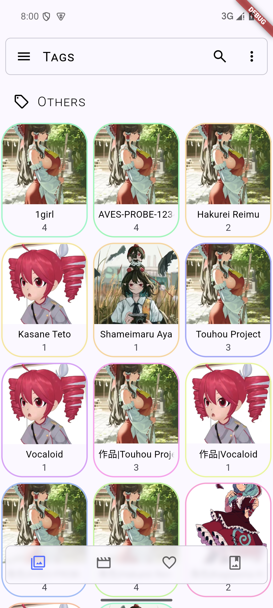
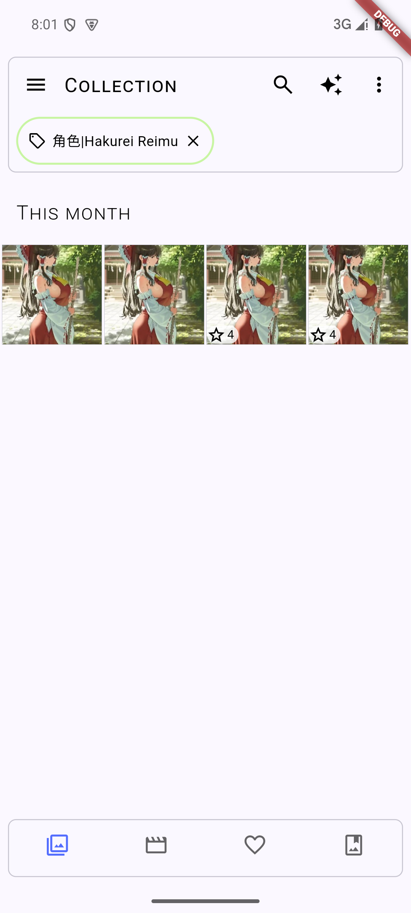
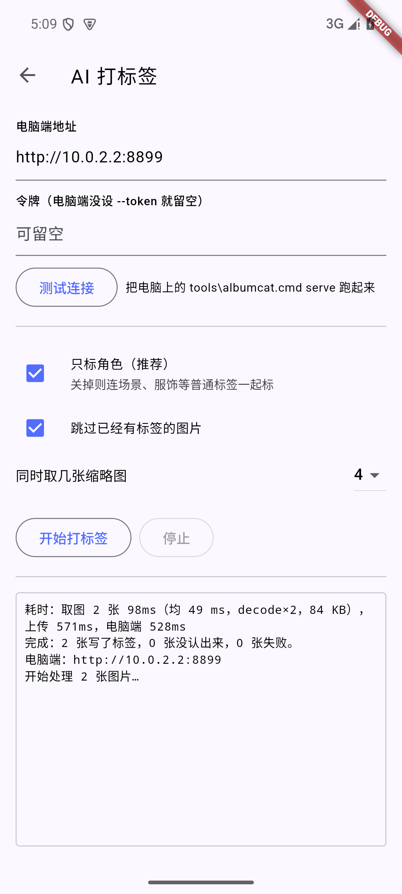

# albumcat

**用 WD14 给手机相册自动打动漫角色标签，在第三方相册里按 `角色` 浏览。**


[](https://github.com/Shuul0707/wd14_albumcat/releases)

> 手机端 APK 在 [Releases](https://github.com/Shuul0707/wd14_albumcat/releases)：一个包内含 arm64-v8a / armeabi-v7a / x86_64 三套 Flutter 引擎，真机和模拟器都能装（装过 v0.3.0/v0.4.0 的话请换 v0.4.1，前两个包在 arm64 真机上会一打开就退出）。
> 电脑端按下面[快速开始](#快速开始)跑起来，两边连同一个 Wi-Fi 就能开始打标签。

手机里攒了几千张同人图和截图，想按角色翻，系统相册却只能按时间。albumcat 把
[WD14 tagger](https://huggingface.co/SmilingWolf/wd-v1-4-vit-tagger-v2)（9083 个标签，其中 2132 个角色名）
接到你的相册上：手机只把 448 px 缩略图发给电脑做推理，标签回来存进 Aves 自己的数据库。

- **手机端很轻** —— 356 MB 的模型和 ONNX 运行时都留在电脑上，手机上只有取缩略图这一个动作。
- **层级标签** —— `角色|Shameimaru Aya`、`作品|Touhou Project`、`分级|R18`，点一下筛出某个角色的全部图片。
- **可插插件** —— 在 WD14 之后接自己的模型，比如对某个 IP 的角色做精准识别。
- **抗中断** —— 一批一落盘。拔线、手机被杀、电脑端消失，只丢正在飞的那几批，已保存的标签留着。

## 它长什么样

<p align="center">
  
  
  
</p>

左：Aves 的 Tags 页里 `角色|Hakurei Reimu`、`角色|Shameimaru Aya` 这些磁贴。
中：点其中一个，集合里只剩这个角色的照片。右：手机上的打标签页面。

## 怎么工作

```text
手机相册（DCIM/…）
      │  ① 手机上自己解出 448 px 的 JPEG 缩略图（约 43 KB/张）发给电脑
      │     原图既不上传、也不在手机上解码推理
      ▼
电脑（只在打标时需要开着）
   albumcat 管线
     1. WD14 ONNX 推理   → 角色 / 通用标签 / 分级
     2. 插件（可选）      → 追加识别结果，比如特定 IP 角色的精准识别
     3. 规则引擎          → 决定打哪些标签，置信度落在复核带的交给人看
     4. 返回标签列表
        （可选）Chinese-CLIP 图像塔 → 512 维语义向量，跟标签一起回传
      │  ② 层级标签  角色|Shameimaru Aya + 语义向量（走 HTTP，不落盘）
      ▼
手机上的 Aves：标签写进它自己的 appTags 表，按 角色 → Shameimaru Aya 浏览
```

标签落在 Aves 自己的 `appTags` 表里，和照片自带的标签并集显示，所以 Tags 页和筛选直接就能用。
fork 的源码在 [aves/](aves/FORK.md)，改了哪些地方、怎么构建都写在里面。

## 在手机上搜：一句话，两种信号

打标那一趟顺带把 512 维语义向量也存进 Aves 的 `appVectors` 表。于是手机里有一个搜索框，
它同时听懂**点名的标签**和**描述的画面**：

```text
「黑暗的初音未来」
   ├─ 标签半边：初音未来 → hatsune_miku（WD14 角色标签，最优先）
   │            黑暗     → dark       （普通标签）
   └─ 向量半边：「黑暗」 → Chinese-CLIP → 和每张图的向量算余弦
                    ↓
   命中了初音未来的照片先排（这一层是硬门槛），其中更暗的更靠前
```

没有点名角色时，标签和向量各占一半：「金发双马尾的夜晚」既筛 `blonde_hair` + `twintails`，
也按「夜晚」的语义排序。查询里一个标签都没点中时，就退化成纯语义搜索。

这就是 Aves 原来那个搜索框，不是另开的页面：输入一句话，回车，网格按相关度排给你；
点开第一张往后滑，顺序跟网格一致。写 `tag:xxx`、`#hash`、`rating>3` 这类 Aves 自己的查询语法时
照旧走原生筛选，不会被语义接管。结果页顶上那一行会写出它听懂了什么
（`识别到 昏暗 · 初音未来（角色），相册里没有这些角色的标签，改按「黑暗」和画面相似度排序 · 12 张`）。

中文是查出来的，不是猜出来的：WD14 的 9083 个英文标签有一张
[中文对照表](docs/SEMANTIC.md#7-中文对照表)（95.9% 有中文名，来自 MIT 授权的 Danbooru 对照表），
`1girl` 认成「女孩 / 单个女孩」，角色名连系列一起认（「东方的角色」= 东方 Project 全员）。
融合打分的代码在 `aves/lib/services/hybrid_ranking.dart`，有 11 个单测钉住每一条规则。

## 快速开始

### 1. 电脑端

```bat
python tools\download_model.py     REM 下模型（356 MB）到 models\vit\，默认走 hf-mirror
tools\install_deps.cmd             REM 建 .venv 并装依赖（含 OCR）；默认 onnxruntime-directml，加 --cpu 强制 CPU、--no-ocr 不要 OCR
tools\albumcat.cmd doctor          REM 自检：模型、依赖、推理后端、插件
tools\albumcat.cmd serve           REM 起手机要连的 HTTP 服务，默认 0.0.0.0:8899
```

就这样跑最简单。想把它当包用（终端里直接 `albumcat`、能跑 `pytest`）：
`pip install -e ".[dml,dev,ocr]"`（`ocr` 那项就是读图上文字的引擎，见 [OCR](docs/OCR.md)），环境细节见 [参与开发](CONTRIBUTING.md)。

先不碰手机，用本地图看效果：

```bat
tools\albumcat.cmd plan samples\
```

`samples\` 里有几张样例图；换成自己的目录就递归扫描。想给角色做精准识别插件，再跑一次
`python tools\add_feature_output.py`（多出一个 373 MB 的特征模型），见 [插件](docs/PLUGINS.md)。

### 2. 手机端

1. 装 fork 版 Aves：去 [Releases](https://github.com/Shuul0707/wd14_albumcat/releases) 下 APK（一个包三种 ABI 的引擎，真机模拟器通用，**认准 v0.4.1 或更新**），
   或者按 [aves/FORK.md](aves/FORK.md) 自己构建；装好授权照片访问；
2. 右上角 ✨ → **AI 打标签** → 填电脑地址 `http://192.168.1.10:8899` → **开始打标签**；
3. 打完到 **Tags** 页，`角色|…` 会出现在那里。

手机和电脑不在同一个局域网？插数据线跑一次 `tools\phone_link.cmd`，**地址不用改**——
App 会先探你填的地址，探不通就换手机自己的回环地址 `http://127.0.0.1:8899`（隧道到电脑，完全不经过防火墙）。
连不上先看 [手机端](docs/PHONE.md)。

## 命令一览

| 命令 | 作用 |
|---|---|
| `tools\albumcat.cmd doctor` | 自检模型、依赖、推理后端、插件 |
| `tools\albumcat.cmd plan <路径>` | 只打印：每张图会给什么标签 |
| `tools\albumcat.cmd serve [--port 8899] [--token X]` | 起手机端要连的服务 |
| `tools\albumcat.cmd plugins` / `model` | 列出插件 / 打印模型的输入输出与特征宽度 |
| `tools\albumcat.cmd train --data … --out …` | 用标注样本训练一个 `feature` 插件 |
| `tools\phone_link.cmd` | 没有局域网时，把手机的 `127.0.0.1:8899` 接到电脑 |
| `python tools\serve_semantic_demo.py --dir samples` | 浏览器里看语义搜索效果（不用手机、不用 Aves） |
| `tools\serve_semantic_demo.cmd [目录]` | 同上，双击就行；不带参数用 `samples\` |

## 配置

所有值都有默认值，写在 `config.toml` 里的覆盖默认；**未知 key 直接报错**（防止打错字被静默忽略）。
环境变量 `ALBUMCAT_<SECTION>_<FIELD>` 优先于文件，比如 `ALBUMCAT_MODEL_DEVICE=cpu`。

| key | 默认 | 说明 |
|---|---|---|
| `model.dir` | `models/vit` | `model.onnx` + `selected_tags.csv` 所在目录 |
| `model.device` | `auto` | 依次挑 DirectML → CUDA → CPU，也可写死 `dml`/`cuda`/`cpu` |
| `model.threshold` | `0.35` | 通用标签的最低分 |
| `model.character_threshold` | `0.5` | 角色标签的最低分（误报比漏报烦人，上游也建议 0.5 起） |
| `model.gpu_mem_limit_mb` | `4096` | DirectML 显存上限，8 GB 卡上留余量 |
| `publish.review_low` / `review_high` | `0.5` / `0.7` | 复核带：低于 low 丢弃、中间标记待复核、高于 high 发布 |
| `publish.publish_review_band` | `false` | 连复核带里的一起发布 |
| `publish.max_characters_per_image` | `3` | 一张图最多认几个角色 |
| `publish.max_general_tags_per_image` | `25` | 通用标签上限（按分数取最高的） |
| `publish.general_tag_denylist` | `[]` | 永不发布的关键字，比如 `commentary`、`watermark` |
| `publish.*_root` | `角色` `作品` `版权` `分级` | 标签树的根 |
| `publish.tree_in_subject` | `true` | 层级标签也放进扁平列表 —— 手机端存的就是扁平那份 |
| `plugins.enabled` / `dir` / `disabled` | `true` / `plugins` / `[]` | 插件注册表 |

`config.toml` 里每个 key 都有注释，可以直接当参考读。

## 标签长什么样

| 来源 | 标签 | 说明 |
|---|---|---|
| 角色 | `角色\|Hakurei Reimu` | WD14 角色标签，`hakurei_reimu_(touhou)` 会把括号里的作品名剥出来 |
| 作品 | `作品\|Touhou Project` | 从角色标签的括号内容推导 |
| 分级 | `分级\|R18`、`分级\|敏感`、`分级\|轻微` | 来自 WD14 的 rating head |
| 通用 | `1girl`、`twintails` … | 有数量上限，可用 denylist 过滤 |
| 插件 | 由插件决定 | 例如 `低质量图片` |

层级分隔符在 Aves 里写成 `|`（它把整串当作一个扁平标签名）。

## 手机端要点

- **取图**：默认走 Aves 的 debug MethodChannel，用 `BitmapFactory` 自己解原文件（power-of-two 采样 → `RGB_565` → 长边缩到 448 px → 按 EXIF 转正 → JPEG `quality=88`），解不出来才退回系统缩略图。
- **一批 8 张、批内 4 路并发**：取一张送一张，不等整批取完。
- **透明底 PNG 先压白底**，否则立绘会变黑底。
- **打标中途断了**：已经打好的标签不会丢，一批一落盘；单批失败自动重试一次，连着 3 批失败才停。

地址怎么填、连不上先看哪里，见 [手机端](docs/PHONE.md)。

## 性能

服务端（RTX 5060 Laptop，DirectML）：**约 102 ms/张**；同一台机器只跑 CPU 是 627 ms/张。

手机侧（安卓 15 模拟器，24 张，服务端同机）：端到端 **2.8 s**，取图约 95 ms/张，每张上传约 43 KB。

## 项目结构

```text
src/albumcat/        服务端：配置 / WD14 推理 / 规则 / 插件 / Chinese-CLIP / HTTP 服务 / 命令行
aves/                手机端：Aves 的 fork 源码（标签与语义向量存进它自己的 appTags / appVectors 表）
tools/               命令行入口、构建与验证脚本（albumcat.cmd、aves_build.ps1、verify_aves_tags.py …）
plugins/             插件目录（示例 + 训练产物）
tests/               pytest：规则、标签字段映射、配置（`python -m pytest`，不用模型）
docs/                延伸阅读与 UI 证据截图
config.toml          全部配置项，注释齐全
pyproject.toml       能 `pip install -e ".[dml,dev]"`（要多带 `,ocr` 才有识字引擎），也带着 pytest 的配置
.github/workflows/   CI：pytest + 仓库卫生（Flutter 侧手动触发）
```

完整目录树与验证脚本见 [开发与验证](docs/DEVELOPMENT.md)，fork 的构建方式见 [aves/FORK.md](aves/FORK.md)。
构建产物（APK）不进仓库，放在 [Releases](https://github.com/Shuul0707/wd14_albumcat/releases)。

## 文档

| 文档 | 内容 |
|---|---|
| [设计说明](docs/DESIGN.md) | 标签存在哪、管线技术要点 |
| [手机端](docs/PHONE.md) | App 用法、连接排错、数据线备用通道、中断保护、真机烟测 |
| [安装与用法](docs/USAGE.md) | 装依赖、下模型、配置、自检、标签格式 |
| [插件](docs/PLUGINS.md) | 在 WD14 之后接自己的模型，训练一个角色插件 |
| [语义搜索](docs/SEMANTIC.md) | Chinese-CLIP 向量 + 中文标签对照表 + 混合检索（「黑暗的初音未来」怎么排） |
| [图片文字识别](docs/OCR.md) | OCR 把图上的字变成可搜索索引：按张开启、实测耗时、手机端怎么搜、在哪看一张图的文字 |
| [开发与验证](docs/DEVELOPMENT.md) | 验证脚本、目录树 |
| [参与开发](CONTRIBUTING.md) | 环境、改完怎么验、代码风格、跟着上游升级、许可 |
| [aves/FORK.md](aves/FORK.md) | 手机端 fork：相对上游改了什么、怎么构建、怎么升上游 |

## 已知限制

- 打标时**电脑必须开着**：模型和 onnxruntime 都在电脑上。
- 抗中断覆盖「电脑端消失 / 连接断」；App 进程被系统直接杀掉时，正在飞的那批仍会丢。
- 标签只存在于 Aves（fork 版）自己的数据库里，换个相册 App 就看不到。
- **第一次构建要装 JDK 21 + Flutter 3.47.6**：`aves/` 里是完整源码，按 [FORK.md](aves/FORK.md) 来；
  只是想用就直接下 [Releases](https://github.com/Shuul0707/wd14_albumcat/releases) 里的 APK（debug 签名，随便装）。
- 自动打出来的标签是**建议**：角色阈值故意定得高，宁可漏报。
- 分级标签来自 WD14 的 rating head，内容合规由使用者自己负责。
- **语义搜索（按「沙滩」这种描述找图）要另导一份模型**：权重不在仓库里，没导出时 `/semantic`
  报 `available: false`、打标完全照旧；手机上没把文本塔下到本机时查询要回落电脑端，所以电脑得开着。
- **混合检索的标签解析在电脑端**：中文对照表约 1 MB，随服务端走，`POST /query` 负责切词；
  电脑不在线时搜索退化成纯向量（手机上装了文本塔的话），点名的角色名不会再起作用。
  详见 [docs/SEMANTIC.md](docs/SEMANTIC.md)。

## 许可

**MIT** —— 见 [LICENSE](LICENSE)：随便用、随便改、商用也行，保留版权声明就够。

有一处范围要注意：`aves/` 是 [Aves](https://github.com/deckerst/aves) 的 fork，沿用上游
**BSD 3-Clause**（源码在 [aves/](aves/FORK.md)，版权与许可证原文见 `aves/LICENSE`）。用到的其他上游组件：
[wd14-API-onnx](https://github.com/bilebee/wd14-API-onnx)（MIT，用于核对预处理）、
模型 [`wd-v1-4-vit-tagger-v2`](https://huggingface.co/SmilingWolf/wd-v1-4-vit-tagger-v2)（以模型页条款为准）。
